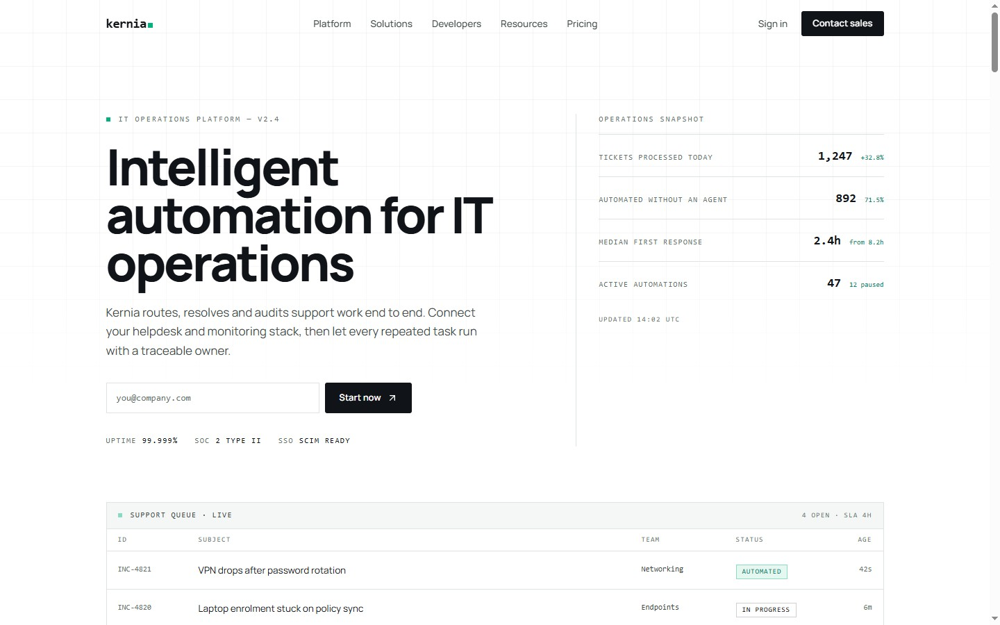

# Kernia

Marketing site for Kernia, an AI operations platform for IT support teams. One route, ten sections plus the footer, built with Next.js 14, TypeScript and Tailwind CSS.

Live: <https://kernia.vercel.app>



Proprietary demo — see [License](#license).

## What it is

A single page (`/`) that tells the product story in ten bands: hero with a live ticket queue, client strip, platform features, global scale, use cases by team, enterprise cases, startup onboarding, developer API, integrations directory, closing CTA and footer.

It is a front-end demo. There is no backend, authentication or CMS, and every form and link is a placeholder. Customer names, metrics and case studies are fictional.

## Why this instead of a landing template

- **A control-room visual language.** Ink `#101317`, signal green `#00b37e` and paper `#f4f7f6` on a 4 px radius scale, with hairline rules instead of cards and no skewed gradients or floating dashboard mockups.
- **Type with two jobs.** Manrope carries headings and body copy; a monospace stack carries labels, ticket IDs and metrics so data reads as data.
- **Layouts, not decoration.** The hero is a queue table, features are instrument panels, use cases are a matrix and the developer section is a terminal. Each band has its own structure, so swapping one does not drag the others along.
- **Two shared layers only.** `landing/shell.tsx` provides `Shell`, `SectionHead`, `Eyebrow` and `Rule`; everything else is one isolated component per section.

## Quick start

Requirements: Node.js 18.17 or newer and npm.

```bash
git clone https://github.com/JORDANROBERTO74/kernia.git
cd kernia
npm install
npm run dev
```

Open <http://localhost:3000>.

| Command | What it does |
| --- | --- |
| `npm run dev` | Start the development server |
| `npm run build` | Create an optimized production build |
| `npm run start` | Serve the production build |
| `npm run lint` | Run ESLint |
| `npx tsc --noEmit` | Type check without emitting |

## Design tokens

`tailwind.config.ts` maps the brand scale; `src/app/globals.css` holds the shadcn/ui variables, the `.shell` and `.eyebrow` utilities, and the ruled-grid and dot-field backgrounds.

| Token | Value | Use |
| --- | --- | --- |
| `ink` | `#101317` | headings, dark surfaces |
| `ink-soft` | `#3f4a48` | body copy |
| `ink-mute` | `#68736f` | meta labels, captions |
| `signal` | `#00b37e` | state and primary actions |
| `signal-deep` | `#00795a` | links on light surfaces |
| `paper` | `#f4f7f6` | alternating section background |
| `line` | `#dde4e2` | hairlines and borders |

To restyle: change the tokens in `tailwind.config.ts`, the Manrope settings in `src/app/layout.tsx`, the wordmark in `src/components/navigation.tsx` and the icon in `src/app/icon.svg`. Layout components use tokens throughout; a handful of SVG strokes keep literal colours.

## Project structure

```text
src/
  app/                 App Router entry, metadata, global styles, icon, OG image
  components/
    landing/           One file per section plus shell.tsx primitives
    navigation.tsx     Fixed nav with mobile sheet and section anchors
    commons/           Legacy client logo, no longer rendered
    ui/                shadcn/ui primitives
  lib/                 Utilities and unused dashboard hooks
docs/                  README screenshot
```

## Deployment

Deploys to Vercel from `main`; pushing to `main` triggers a production build.

## Status and scope

`npm run lint`, `npx tsc --noEmit` and `npm run build` pass, with a visual pass at 1440 px and 390 px. Out of scope: real form submission, analytics, i18n, dark mode and the unused logo in `src/components/commons`.

## License

Proprietary. See [LICENSE](LICENSE).
